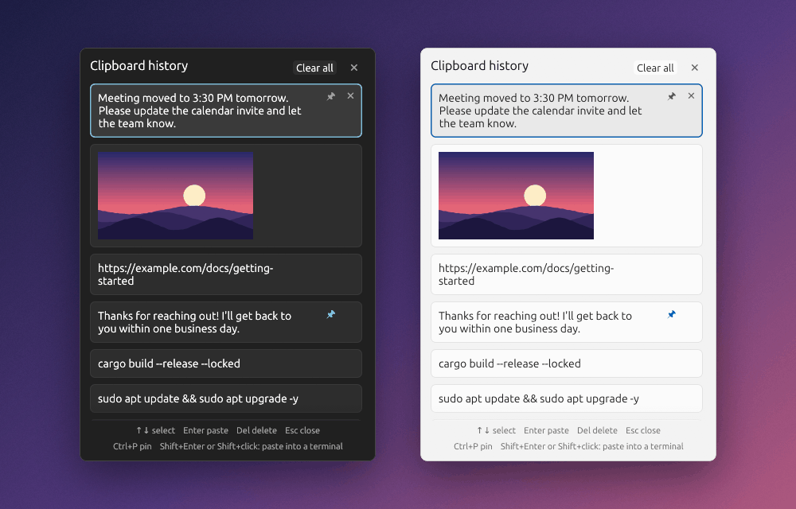
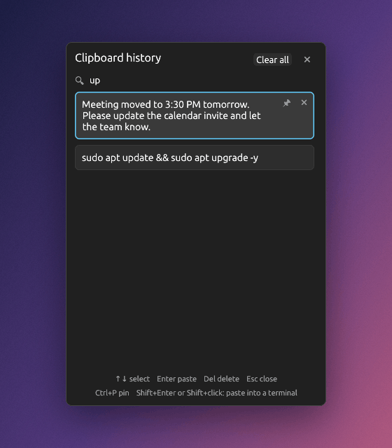

<div align="center">

# 📋 winv-clipboard

**The Windows <kbd>Win</kbd>+<kbd>V</kbd> clipboard history, for Ubuntu.**<br>
Press <kbd>Super</kbd>+<kbd>V</kbd>, pick something you copied earlier, and it's pasted.

[](https://github.com/ajaysavaliya8/winv-clipboard/releases)
[](#install)
[](#how-it-works)
[](#install)
[](LICENSE)



</div>

<br>

## ✨ Features

- **Super+V history popup** that opens right at your mouse pointer, like on Windows.
- **Text and images.** The last 25 copies are kept, and you can **📌 pin** the ones you always need.
- **Type to search** your history instantly.
- **Pastes for you.** Click an item and it lands in the window you were using, terminals included.
- **Follows your theme.** Light or dark, matching your system.
- **Starts by itself** every time you log in to Ubuntu. Nothing to set up.
- **Private.** Never touches the network, ignores passwords from password managers, and stores
  history only for your user.
- **Light.** The background service uses about 5 MB of memory, and the popup is a separate program
  that only runs while it is open.

## 🚀 Install

One command. **No sudo, no building, no permissions to grant.**

```bash
curl -fsSL https://raw.githubusercontent.com/ajaysavaliya8/winv-clipboard/main/install.sh | bash
```

That's it. Copy something, then press <kbd>Super</kbd>+<kbd>V</kbd>.

The installer downloads the program, verifies its checksum, and sets everything up **for your user
only**:

| It does | Where |
|---|---|
| installs the program | `~/.local/bin/winv-clipboard` |
| **starts it at every login** | `~/.config/autostart/winv-clipboard.desktop` |
| binds <kbd>Super</kbd>+<kbd>V</kbd> | a normal GNOME keyboard shortcut |
| adds a "Clipboard history" launcher | `~/.local/share/applications/` |

> [!NOTE]
> <kbd>Super</kbd>+<kbd>V</kbd> is GNOME's shortcut for the notification tray, so the installer
> leaves the tray on <kbd>Super</kbd>+<kbd>M</kbd> only. Uninstalling gives it back.

**Upgrade** by running the same command again; your history is kept.
**Pin a version** with `curl -fsSL <address> | WINV_VERSION=v1.0.0 bash`.
No `curl`? Use `wget -qO- <address> | bash`.

<details>
<summary><b>Install from source instead</b></summary>

<br>

```bash
git clone https://github.com/ajaysavaliya8/winv-clipboard.git
cd winv-clipboard
./install.sh
```

This builds the program when Rust ([rustup](https://rustup.rs)) and a C compiler
(`sudo apt install build-essential`) are installed, and otherwise falls back to the download above.

</details>

**Requirements:** Ubuntu 22.04 or newer with the GNOME desktop (Wayland or X11), on Intel/AMD or ARM.
So far it has been tested on Ubuntu 26.04 (GNOME 50, Wayland, Intel/AMD) only.

### 🔁 Starts at every login

The installer adds the standard Ubuntu/GNOME autostart entry, so the clipboard service is running
from the moment you log in, with no systemd, root or extra setup. If the service is ever not
running when you press <kbd>Super</kbd>+<kbd>V</kbd>, the popup starts it first. To stop it starting
automatically, run `winv-clipboard uninstall`, or just delete that one `.desktop` file.

## ⌨️ Using it

<table>
<tr>
<td valign="top">

| Key / action | What it does |
|---|---|
| <kbd>Super</kbd>+<kbd>V</kbd> | Open the popup at the mouse pointer (press again to close) |
| Click an item, or <kbd>↑</kbd> <kbd>↓</kbd> / <kbd>Tab</kbd> then <kbd>Enter</kbd> | Paste it into the window you were using |
| <kbd>Shift</kbd>+<kbd>Enter</kbd> or <kbd>Shift</kbd>+click | Paste into a **terminal** (sends <kbd>Ctrl</kbd>+<kbd>Shift</kbd>+<kbd>V</kbd>) |
| Just **type** | Search the history |
| <kbd>Ctrl</kbd>+<kbd>P</kbd> or the 📌 button | Pin / unpin an item |
| <kbd>Del</kbd> or the ✕ on an item | Delete one item |
| **Clear all** | Delete everything except pinned items |
| <kbd>Esc</kbd>, the ✕ in the corner, or a click anywhere outside | Close |

</td>
<td valign="top" width="300">



<sub>Type to filter. Here, <code>up</code> finds two items.</sub>

</td>
</tr>
</table>

Keeps the **25 most recent** items plus any pinned ones. Text up to 4 MB and images are supported.

## 🪟 Behaves like Windows

- Same layout, and the light/dark theme follows your system.
- "Clear all" keeps pinned items.
- **History is cleared when the computer restarts** (pinned items stay), because clipboards often
  hold passwords. To keep it across restarts:
  ```bash
  mkdir -p ~/.config/winv-clipboard && touch ~/.config/winv-clipboard/keep-history
  ```
  Restarting only the service, or logging out and back in, never clears anything.

## 🔒 Privacy

- **Local only.** There is no network code in the program at all.
- History lives in `~/.local/share/winv-clipboard`, readable by your user only (`0600`/`0700`).
- Copies that an app marks as a password (for example from KeePassXC) are **not recorded**.
- **Logs never contain what you copied**, only sizes and ids.

## ⚙️ How it works

<details>
<summary><b>Two small programs in one binary</b></summary>

<br>

- `winv-clipboard daemon` is the service. It watches the clipboard, owns the history, and is started
  by the autostart entry. It restarts itself if the display connection is lost, and only one copy
  can run.
- `winv-clipboard show` is the popup (built with [egui](https://github.com/emilk/egui)). It is a
  separate short-lived process, so it can never slow your desktop down while closed.
- Pasting puts the item on the clipboard, then sends <kbd>Ctrl</kbd>+<kbd>V</kbd> through GNOME's
  RemoteDesktop service (this works in Wayland windows), falling back to X11 for X11 windows.
- The popup is placed at the pointer using a brief invisible window, because Wayland hides the
  pointer from apps that have no window under it.

</details>

## 🩺 Logs and troubleshooting

```bash
winv-clipboard log          # last 40 lines of the full log (kept 1 day)
winv-clipboard log errors   # last 40 lines of the errors-only log (kept 5 days)
```

Files in `~/.local/share/winv-clipboard/`: `winv.log` (everything, 1 day) and `winv-errors.log`
(`ERROR`/`PANIC` only, 5 days). Old lines are removed automatically.

| Problem | Try |
|---|---|
| <kbd>Super</kbd>+<kbd>V</kbd> does nothing | Run `winv-clipboard log errors`; then `winv-clipboard show` in a terminal |
| `winv-clipboard: command not found` right after installing | Ubuntu adds `~/.local/bin` to your PATH at the next login. Until then use `~/.local/bin/winv-clipboard` |
| History is empty after a restart | That is intended (see above). Pin items, or enable `keep-history` |
| A shortcut conflicts with another app | Change or remove it in **Settings → Keyboard → Shortcuts** |

## 🗑️ Uninstall

```bash
~/.local/bin/winv-clipboard uninstall            # keeps your history and logs
~/.local/bin/winv-clipboard uninstall --purge    # deletes them too
```

This removes the program, the automatic start and the shortcut, and gives
<kbd>Super</kbd>+<kbd>V</kbd> back to the notification tray.

## ⚠️ Known limits

- Copies larger than about 3 MB can be too slow for the X11 clipboard bridge and may not be captured
  (the log says so). Pastes are never blocked by a slow copy.
- GNOME does not tell apps what kind of window has focus, so <kbd>Enter</kbd> always sends
  <kbd>Ctrl</kbd>+<kbd>V</kbd>. Use <kbd>Shift</kbd>+<kbd>Enter</kbd> for terminals.
- egui does not shape complex scripts: Gujarati/Hindi text shows, but conjuncts may look slightly off.
- Text-cursor position is not available on Wayland, so the popup opens at the mouse pointer.
- Ubuntu GNOME only (Wayland or X11).

## 🛠️ Development

```bash
cargo test                       # unit tests
cargo clippy --all-targets       # lints
cargo build --release --locked
```

<details>
<summary><b>Publishing a release</b> (for maintainers)</summary>

<br>

Users install from GitHub Releases, which are built by `.github/workflows/release.yml`. For each
release:

```bash
# 1. bump `version` in Cargo.toml (and run `cargo build` so Cargo.lock follows), commit, push
git tag v1.0.1 && git push origin v1.0.1
```

The workflow tests the code, builds for Intel/AMD and ARM on Ubuntu 22.04 (so the program also runs
on newer versions), and publishes the files with their checksums. The install command then picks up
the new version by itself.

</details>

## 📄 License

[MIT](LICENSE) © Ajay Savaliya
